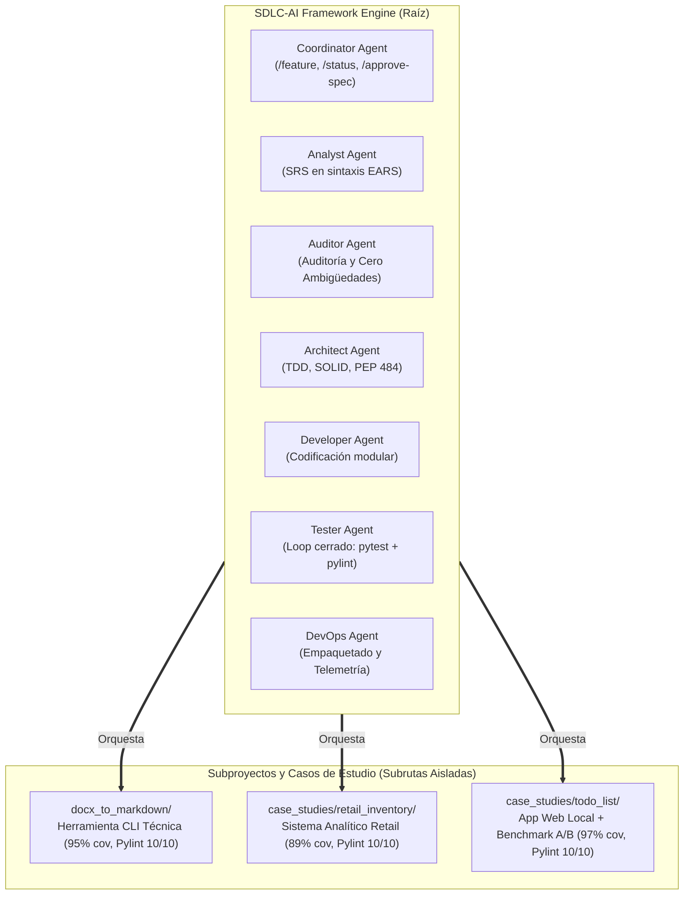

# SDLC-AI: Framework de Inteligencia Artificial Agéntica para el Ciclo de Vida del Software

[](https://www.python.org/)
[]()
[]()
[]()
[]()
[]()

> **Framework de Investigación Aplicada en Ingeniería de Software**  
> **Institución:** Politécnico Grancolombiano — Facultad de Ingeniería, Diseño e Innovación (FIDI)  
> **Investigador Líder:** Miguel Ángel Fajardo Cossio  
> **Asesor Académico:** Wilson Eduardo Soto Forero  
> **Arquitectura:** Engine Multi-Proyecto con Especificación Front-Loaded (Sintaxis EARS) y Bucle Cerrado de QA

---

## 1. Descripción del Framework
**SDLC-AI** es una plataforma de Inteligencia Artificial Agéntica concebida para automatizar, orquestar y controlar con rigor técnico las fases del Ciclo de Vida del Desarrollo de Software (SDLC): análisis de requisitos, diseño arquitectónico, desarrollo, pruebas automatizadas y despliegue.

A diferencia de los asistentes conversacionales aislados que dependen de supervisión humana permanente línea a línea, SDLC-AI implementa el paradigma de **Spec-Driven Development (SDD)** y **Harness Engineering** sobre un entorno multi-proyecto:

1. **Fase de Especificación Asistida (Humano + Agentes):** El investigador colabora con el `Coordinator`, el `Analyst_Agent` y el `Auditor_Agent` para consolidar un Documento de Requisitos (SRS) en sintaxis formal EARS libre de ambigüedades. El flujo se detiene en la pausa obligatoria `WAITING_APPROVAL`.
2. **Pipeline de Ejecución Autónoma (Agentes en Bucle Cerrado):** Tras la aprobación humana explícita (`/approve-spec <task_id>`), el Coordinator materializa la especificación inmutable y encadena a los agentes `Architect`, `Developer`, `Tester` y `DevOps` sin intervención manual hasta certificar los *Quality Gates*.

---

## 2. Arquitectura del Sistema Multi-Agente



---

## 3. Puertas de Calidad Innegociables (Quality Gates)

| Métrica de Calidad | Umbral Exigido | Resultado Obtenido en SDLC-AI | Estado |
| :--- | :---: | :---: | :---: |
| **Análisis Estático (Pylint)** | $\ge 7{,}0 / 10{,}0$ | **10.00 / 10.0** (3 subproyectos certificados) | ✅ SUPERADO |
| **Cobertura de Pruebas (Pytest-cov)** | $\ge 80\%$ | **89%** (Retail) / **95%** (DOCX) / **97%** (To-Do) | ✅ SUPERADO |
| **Precisión Analítica (Macro F1-score)** | $\ge 0{,}80$ | **0.865** en clasificación de inventarios | ✅ SUPERADO |
| **Batería Ciega de Caos (Benchmark A/B)** | $100\%$ no-regresión | **10/10 (100%)** vs. 7/10 (70%) sin arnés | ✅ SUPERADO |
| **Reducción Preliminar de Tiempo ($\Delta T$)** | $\ge 30\%$ | **79.04%** frente a estimación paramétrica | ✅ SUPERADO |

---

## 4. Estructura del Repositorio (Patrón Engine Multi-Proyecto)

```text
.
├── .agents/skills/                   # Catálogo de 11 habilidades modulares progresivas
│   ├── python_architect/             # Directrices SOLID, PEP 484 y diseño TDD
│   ├── web_engineering/              # Ingeniería web y APIs
│   ├── data_science/                 # Análisis numérico y modelos de datos
│   ├── big_data/                     # Procesamiento escalable
│   ├── business_intelligence/        # Modelado de métricas e indicadores
│   ├── math_statistics/              # Fórmulas y validaciones estadísticas
│   ├── document_conversion/          # Manipulación OOXML y Markdown
│   └── retail_strategist/            # Heurísticas de dominio (caso de estudio)
├── .opencode/
│   ├── agents/                       # Descriptores universales de agentes (100% agnósticos)
│   └── commands/                     # Comandos CLI (/feature, /status, /approve-spec)
├── docs/
│   ├── constitution.md               # Leyes invariables y Quality Gates del framework
│   ├── antigravity_cli_runbook.md    # Manual operativo del arnés Antigravity CLI
│   └── agent_efficiency_benchmark.md # Benchmark experimental de calidad y tokens
├── tests/
│   └── test_agent_harness.py         # Suite de pruebas de gobernanza del framework
├── AGENTS.md                         # Protocolo de roles y políticas de contexto
├── ANTIGRAVITY.md                    # Máquina de estados, handoffs mínimos y despacho
├── pyproject.toml                    # Configuración de entorno de pruebas
├── run.sh                            # Orquestador multi-proyecto "one-click"
│
├── docx_to_markdown/                 # Subproyecto 1: Convertidor DOCX a Markdown (Herramienta CLI)
│   ├── src/                          # Código fuente del convertidor (95% cobertura)
│   ├── tests/                        # Suite de 18 pruebas unitarias
│   └── run.sh                        # Verificador autónomo del subproyecto
│
├── case_studies/retail_inventory/    # Caso de Estudio 1: Sistema Analítico Retail de Moda
│   ├── src/                          # Motor de ingesta, KPIs, alertas, Gemini y Excel
│   ├── tests/                        # Suite de 27 pruebas unitarias (Pylint 10/10)
│   ├── data/                         # Dataset de validación con 450 SKUs
│   ├── specs/                        # Especificaciones EARS de los Sprints 1 a 4
│   ├── logs/                         # Reporte narrativo, Excel de reposición y telemetría
│   └── run.sh                        # Verificador autónomo del caso de estudio
│
├── case_studies/todo_list/           # Caso de Estudio 2: App Web Local To-Do List (SDLC-AI)
│   ├── src/todo_list/                # Arquitectura limpia (models, repository, service, web)
│   ├── tests/                        # Suite de 11 pruebas unitarias (97% cobertura, Pylint 10/10)
│   ├── specs/sprint_01/              # Especificación EARS auditada y plan técnico
│   └── run.sh                        # Verificador autónomo del caso de estudio
│
└── benchmarks/todo_list/             # Experimento Controlado A/B (Línea Base vs. SDLC-AI)
    ├── sesion_a_baseline/            # Solución generada sin arnés y bitácora exportada
    ├── blind_chaos_suite.py          # Batería ciega de 10 pruebas funcionales y de caos
    └── REPORTE_COMPARATIVO_TESIS.md  # Informe comparativo de tiempos y calidad
```

---

## 5. Instrucciones de Ejecución Rápida

### Requisitos Previos
- Python 3.10 o superior en Linux / macOS / WSL.
- Git y Bash.

### Ejecución Integral de Todos los Proyectos
```bash
git clone https://github.com/MiguelFajardoDev98/sdlc-ai.git
cd sdlc-ai
chmod +x run.sh docx_to_markdown/run.sh case_studies/retail_inventory/run.sh case_studies/todo_list/run.sh

# Ejecuta el arnés, docx_to_markdown, retail_inventory, todo_list y la batería ciega A/B
./run.sh all
```

### Ejecución Focalizada por Proyecto
```bash
# Probar únicamente el arnés y contratos agénticos:
./run.sh harness

# Probar el subproyecto de conversión documental:
./run.sh docx

# Probar el caso de estudio de retail de moda:
./run.sh retail

# Probar el caso de estudio To-Do List y el benchmark comparativo A/B:
./run.sh todo
```

---

## 6. ¿Cómo Crear un Nuevo Caso de Estudio o Herramienta?

El framework SDLC-AI permite crear cualquier nuevo desarrollo en su propia subruta sin tocar el código existente:

1. **Solicitar el nuevo requerimiento al Coordinator:**
   ```text
   /feature Desarrollar una API de procesamiento de pagos bancarios --project case_studies/fintech_payments
   ```
2. **Fase Asistida:** El `Analyst_Agent` y el `Auditor_Agent` generan `case_studies/fintech_payments/specs/spec.md`.
3. **Aprobación:** Ejecutas `/approve-spec fintech_payments`.
4. **Pipeline Autónomo:** Los agentes `Architect`, `Developer`, `Tester` y `DevOps` generan el código en `src/`, las pruebas en `tests/` y el ejecutor `run.sh` dentro de esa subruta, certificando los Quality Gates de forma 100% aislada.

---

## 7. Créditos y Citación Académica
- **Investigador:** Miguel Ángel Fajardo Cossio (`manfajardoc@poligran.edu.co`)
- **Asesor:** Wilson Eduardo Soto Forero
- **Trabajo de Grado:** *SDLC-AI: Framework de Inteligencia Artificial Agéntica para el Ciclo de Vida del Desarrollo de Software*. Politécnico Grancolombiano, 2026.
