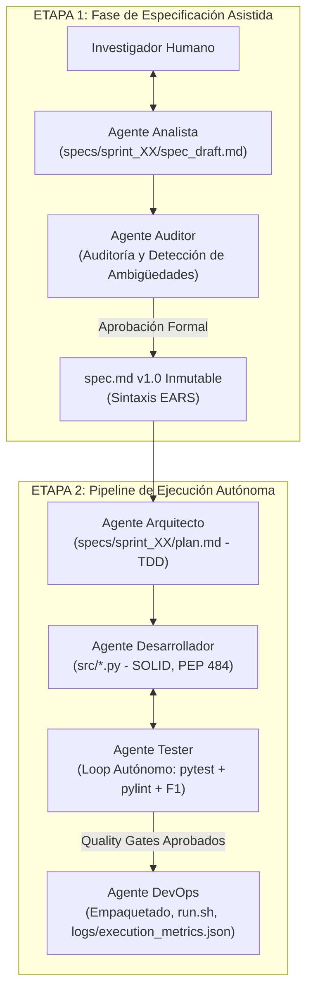

# SDLC-AI: Framework de Inteligencia Artificial Agéntica para el Ciclo de Vida del Software

[](https://www.python.org/)
[]()
[]()
[]()
[]()
[]()

> **Trabajo de Grado en Ingeniería de Software**  
> **Institución:** Politécnico Grancolombiano — Facultad de Ingeniería, Diseño e Innovación (FIDI)  
> **Tesista / Investigador:** Miguel Ángel Fajardo Cossio  
> **Asesor Académico:** Wilson Eduardo Soto Forero  
> **Caso de Estudio:** Sistema de Alertas de Inventario para el Sector Retail de Moda en Colombia  
> **Convención Estricta de SKU:** `MODELO-TALLA-COLOR` (ej. `CAMISA_OXFORD-M-AZUL`, `JEAN_SLIM-32-INDIGO`)

---

## 1. Descripción del Proyecto
**SDLC-AI** es un framework de Inteligencia Artificial Agéntica diseñado para automatizar y orquestar las fases fundamentales del Ciclo de Vida del Desarrollo de Software (SDLC): análisis de requisitos, diseño arquitectónico, desarrollo, pruebas automatizadas y despliegue.

A diferencia de los enfoques tradicionales de asistencia por IA basados en chats conversacionales interactivos que sufren del "infierno del copy-paste", SDLC-AI implementa una **Arquitectura en Dos Fases** fundamentada en el paradigma de **Spec-Driven Development (SDD)**:

1. **Fase de Especificación Asistida (Etapa 1 - Humano + Agentes):** El
   investigador conversa con `Coordinator`; `Analyst_Agent` y
   `Auditor_Agent` generan `spec_draft.md` y `audit_report.md`, y el flujo se
   detiene en `WAITING_APPROVAL`.
2. **Pipeline de Ejecución Autónoma (Etapa 2):** Después de
   `/approve-spec <task_id>`, el Coordinator materializa `spec.md` y encadena
   `Architect_Agent`, `Developer_Agent`, `Tester_Agent` y `DevOps_Agent`.

---

## 2. Arquitectura del Sistema Multi-Agente



---

## 3. Puertas de Calidad Innegociables (Quality Gates)

| Métrica de Calidad | Umbral Mínimo Requerido | Resultado Obtenido en SDLC-AI | Estado |
| :--- | :---: | :---: | :---: |
| **Análisis Estático (Pylint)** | $\ge 7{,}0 / 10{,}0$ | **10.00 / 10.0** | ✅ SUPERADO |
| **Cobertura de Pruebas (Pytest-cov)** | $\ge 80\%$ | **87%** (26 pruebas exitosas) | ✅ SUPERADO |
| **Precisión Analítica (Macro F1-score)** | $\ge 0{,}80$ | **0.865** sobre dataset de validación | ✅ SUPERADO |
| **Reducción de Tiempo de Ciclo ($\Delta T$)** | $\ge 30\%$ | **79.04%** vs. línea base tradicional | ✅ SUPERADO |

---

## 4. Estructura del Repositorio

```text
.
├── .agents/skills/               # Habilidades normativas especializadas
│   ├── python_architect/         # Directrices SOLID, PEP 484 y TDD
│   └── retail_strategist/        # Heurísticas de moda en Colombia y SKU MODELO-TALLA-COLOR
├── .opencode/
│   ├── agents/                   # Descriptores de roles agénticos y subagentes
│   └── commands/                 # Comandos personalizados (ej. /feature.md)
├── data/
│   └── synthetic_retail_data.csv # Dataset con 450 SKUs de validación multitienda
├── docs/
│   ├── constitution.md           # Constitución técnica inmutable del framework
│   ├── SDLC-AI_Tesis_Entrega1.md # Documento de Entrega 1 (Capítulos 1 a 4)
│   ├── SDLC-AI_Tesis_Entrega2.md # Documento de Entrega 2 (Capítulos 1 a 6)
│   └── SDLC-AI_Tesis_Entrega3.md # Libro de Tesis Completo (Capítulos 1 a 8)
├── logs/
│   ├── executive_report.md       # Informe ejecutivo generado por Gemini Pro / Fallback
│   └── execution_metrics.json    # Registro formal de telemetría y tiempos
├── specs/                        # Especificaciones de Requisitos (SRS) y Diseños (TDD)
│   ├── sprint_01_ingestion/      # Módulo de ingesta y cálculo de KPIs
│   ├── sprint_02_alerts/         # Motor de reglas de inventario
│   ├── sprint_03_gemini/         # Integración y reportería narrativa
│   └── sprint_04_devops/         # Despliegue y evaluación empírica
├── src/                          # Código fuente de producción en Python
│   ├── data_ingestion.py         # Ingesta y validación estricta de SKU
│   ├── kpi_calculator.py         # Cálculo de DCI, TQS y valorización
│   ├── alert_engine.py           # Detección de quiebres, sobrestock y transferencias
│   ├── gemini_reporter.py        # Reportería narrativa con Google Gemini Pro
│   └── main.py                   # Orquestador del pipeline E2E
├── tests/                        # Suite de pruebas automatizadas
│   ├── test_ingestion.py
│   ├── test_kpi.py
│   ├── test_alert_engine.py
│   └── test_reporter.py
├── AGENTS.md                     # Guía operativa y guardarraíles de agentes
├── ANTIGRAVITY.md                # Estados, handoffs y aprobación de specs
├── GITHUB_WORKFLOW.md            # Flujo Git/GitHub entre equipos
├── MEMORY.md                     # Estado vivo, cronograma y registro de ADRs
├── requirements.txt              # Dependencias de Python congeladas
├── run.sh                        # Script de ejecución integral "one-click"
├── README.md                     # Documentación general
└── docx_to_markdown/             # Subproyecto DOCX -> Markdown validado
```

---

## 5. Instrucciones de Instalación y Ejecución "One-Click"

### Requisitos Previos
- Python 3.10 o superior.
- Git y Bash en entorno Linux / macOS / WSL.

### Ejecución Rápida
Clona el repositorio y ejecuta el script principal. Para el flujo completo de
Git/GitHub consulta [`GITHUB_WORKFLOW.md`](GITHUB_WORKFLOW.md):

```bash
git clone https://github.com/usuario/sdlc-ai.git
cd sdlc-ai

# Dar permisos de ejecución
chmod +x run.sh

# Ejecutar verificación de calidad, pruebas unitarias y pipeline analítico
./run.sh
```

### Configuración de Google Gemini Pro (Opcional)
Para habilitar la generación narrativa directa mediante la API de Google Gemini Pro:
```bash
cp .env.example .env
# Editar .env y colocar tu GEMINI_API_KEY
export GEMINI_API_KEY="tu_clave_aqui"
```
*(Nota: Si no se proporciona una API key, el sistema activa automáticamente su motor determinista enriquecido de alta fidelidad, asegurando ejecución y evaluación 100% autónomas y reproducibles).*

---

## 6. Citación y Contacto
Para citar este trabajo o consultar información metodológica:
- **Autor:** Miguel Ángel Fajardo Cossio — `manfajardoc@poligran.edu.co`
- **Tesis:** *SDLC-AI: Framework de Inteligencia Artificial Agéntica para el Ciclo de Vida del Desarrollo de Software (Caso de Estudio: Sistema de Alertas de Inventario para el Sector Retail de Moda en Colombia)*. Politécnico Grancolombiano, 2026.

## 7. Subproyecto DOCX a Markdown

El convertidor independiente está en `docx_to_markdown/`. Su flujo
`sprint_01_conversion` completó especificación, diseño, implementación, QA y
conversión E2E:

```bash
cd docx_to_markdown
./run.sh
cd ..
```

Resultado certificado de la última ejecución: 18/18 pruebas, Pylint 10/10 y
95% de cobertura total.

## 8. Ejecución con Antigravity CLI

La guía operativa para ejecutar el pipeline multiagente, validar cada fase y
comparar el arnés baseline contra el optimizado está en
[`docs/antigravity_cli_runbook.md`](docs/antigravity_cli_runbook.md).
El contrato de estados y handoffs está en
[`ANTIGRAVITY.md`](ANTIGRAVITY.md).
