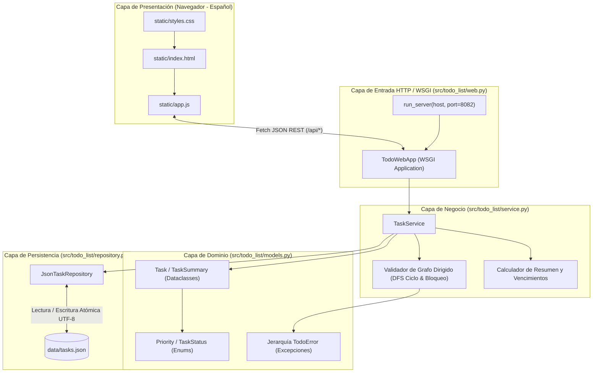
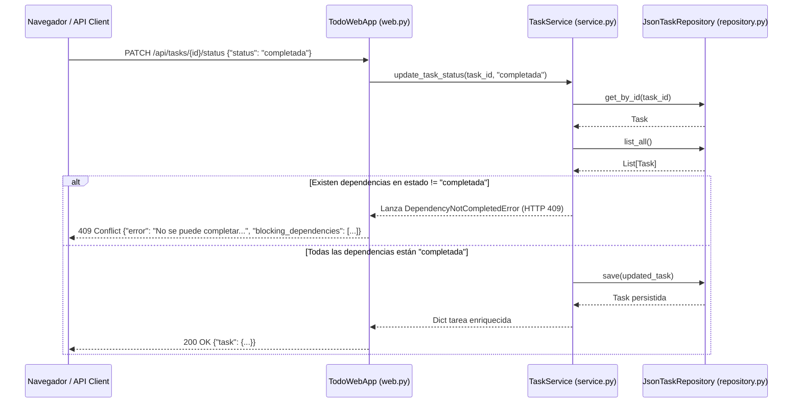
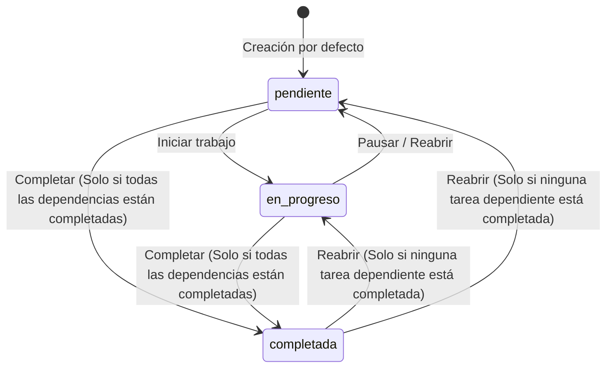

# TECHNICAL DESIGN DOCUMENT (TDD) — SPRINT 01: GESTOR DE TAREAS (TO-DO LIST)

- **Autor:** Agente Arquitecto de Software (`Architect_Agent`)
- **Fase SDLC:** Fase B — Diseño Técnico y Arquitectura
- **Basado en:** `specs/sprint_01/spec.md` (v1.0 Inmutable)
- **Restricción Técnica:** Librería estándar de Python 3 (`dataclasses`, `enum`, `datetime`, `json`, `pathlib`, `uuid`, `wsgiref`, `urllib.parse`, `typing`).

---

## 1. ARQUITECTURA MODULAR POR CAPAS (DIAGRAMA MERMAID)

El sistema aplica una arquitectura limpia desacoplada en cuatro capas: **Presentación Web (SPA Vanilla + WSGI REST API)**, **Capa de Aplicación/Servicio (`TaskService`)**, **Capa de Dominio (`models.py`)** y **Capa de Infraestructura/Persistencia (`JsonTaskRepository`)**.



---

## 2. FLUJO DE VALIDACIÓN DE DEPENDENCIAS Y COMPLETADO (MERMAID)



---

## 3. DIAGRAMA DE ESTADOS DE UNA TAREA (MERMAID)



---

## 4. ESQUEMAS DE DATOS Y JERARQUÍA DE EXCEPCIONES (`src/todo_list/models.py`)

### 4.1 Enumeraciones
```python
class Priority(str, Enum):
    BAJA = "baja"
    MEDIA = "media"
    ALTA = "alta"

class TaskStatus(str, Enum):
    PENDIENTE = "pendiente"
    EN_PROGRESO = "en_progreso"
    COMPLETADA = "completada"
```

### 4.2 Jerarquía de Excepciones de Dominio
- `TodoError(Exception)`: Excepción base del dominio.
- `ValidationError(TodoError)`: Error de validación de campos, fechas `YYYY-MM-DD`, prioridades o estados (`HTTP 400`).
- `TaskNotFoundError(TodoError)`: Tarea no encontrada por su identificador (`HTTP 404`).
- `InvalidDependencyError(ValidationError)`: Referencia a dependencia inexistente o auto-dependencia (`HTTP 400`).
- `CyclicDependencyError(TodoError)`: Detección de ciclo en el grafo de dependencias (`HTTP 409`).
- `DependencyNotCompletedError(TodoError)`: Intento de completar una tarea con dependencias aún no completadas, o de reabrir una tarea de la cual depende otra tarea ya completada (`HTTP 409`).

### 4.3 Entidades (`@dataclass`)
```python
@dataclass
class Task:
    title: str
    description: str = ""
    priority: Priority = Priority.MEDIA
    status: TaskStatus = TaskStatus.PENDIENTE
    due_date: Optional[str] = None
    tags: List[str] = field(default_factory=list)
    dependencies: List[str] = field(default_factory=list)
    id: str = field(default_factory=lambda: str(uuid.uuid4()))
    created_at: str = field(default_factory=...)
    updated_at: str = field(default_factory=...)

    def is_overdue(self, reference_date: Optional[date] = None) -> bool: ...
    def to_dict(self) -> Dict[str, Any]: ...
    @classmethod
    def from_dict(cls, data: Dict[str, Any]) -> "Task": ...

@dataclass
class TaskSummary:
    total: int
    by_status: Dict[str, int]
    by_priority: Dict[str, int]
    overdue_count: int
    blocked_count: int
    completion_rate: float

    def to_dict(self) -> Dict[str, Any]: ...
```

---

## 5. FIRMAS Y CONTRATOS POR MÓDULO

### 5.1 `src/todo_list/repository.py` — `JsonTaskRepository`
- `__init__(self, file_path: Union[str, Path]) -> None`
- `list_all(self) -> List[Task]`: Lee y deserializa todas las tareas; si el archivo está corrupto o vacío, lo respalda en `.corrupt` y retorna `[]`.
- `get_by_id(self, task_id: str) -> Optional[Task]`
- `save_all(self, tasks: List[Task]) -> None`: Escribe de forma atómica mediante archivo temporal `.tmp` y `os.replace`.
- `upsert(self, task: Task) -> Task`
- `delete(self, task_id: str) -> bool`

### 5.2 `src/todo_list/service.py` — `TaskService`
- `__init__(self, repository: JsonTaskRepository) -> None`
- `create_task(self, title: str, description: str = "", priority: str = "media", status: str = "pendiente", due_date: Optional[str] = None, tags: Optional[Sequence[str]] = None, dependencies: Optional[Sequence[str]] = None, task_id: Optional[str] = None) -> Task`
- `get_task(self, task_id: str) -> Task`
- `update_task(self, task_id: str, **changes: Any) -> Task`
- `update_status(self, task_id: str, new_status: str) -> Task`
- `complete_task(self, task_id: str) -> Task`
- `delete_task(self, task_id: str) -> None`
- `list_tasks(self, status: Optional[str] = None, priority: Optional[str] = None, tag: Optional[str] = None, search: Optional[str] = None, overdue_only: bool = False, reference_date: Optional[date] = None) -> List[Task]`
- `enrich_task(self, task: Task, tasks_by_id: Optional[Dict[str, Task]] = None, reference_date: Optional[date] = None) -> Dict[str, Any]`
- `get_blocking_dependencies(self, task: Task, tasks_by_id: Optional[Dict[str, Task]] = None) -> List[Task]`
- `get_summary(self, reference_date: Optional[date] = None) -> TaskSummary`

#### Algoritmo de Detección de Ciclos (DFS con 3 colores):
- Dado el mapa de adyacencia `graph[u] = lista de dependencias de u`, se verifica que para todo nodo `v` alcanzable desde `task_id` no exista camino de regreso a `task_id` (ni ciclos en el grafo resultante).
- Complejidad temporal: $\mathcal{O}(V + E)$, espacial: $\mathcal{O}(V)$.

### 5.3 `src/todo_list/web.py` — Servidor WSGI y API REST
- `TodoWebApp(service: TaskService, static_dir: Optional[Path] = None)`
  - `__call__(self, environ: Dict[str, Any], start_response: Callable[..., Any]) -> Iterable[bytes]`
- Endpoints soportados:
  - `GET /` y `GET /static/<filename>`: Entrega de activos estáticos (`index.html`, `styles.css`, `app.js`).
  - `GET /api/tasks`: Filtros por query string (`status`, `priority`, `tag`, `search`, `overdue_only`).
  - `POST /api/tasks`: Creación de tarea (`201 Created`).
  - `GET /api/tasks/<id>`: Consulta individual (`200 OK` / `404 Not Found`).
  - `PUT /api/tasks/<id>`: Actualización de campos y dependencias (`200 OK`).
  - `PATCH /api/tasks/<id>/status`: Cambio rápido de estado (`200 OK` / `409 Conflict`).
  - `POST /api/tasks/<id>/complete`: Atajo semántico para marcar como completada (`200 OK` / `409 Conflict`).
  - `DELETE /api/tasks/<id>`: Eliminación con limpieza de dependencias (`200 OK`).
  - `GET /api/summary`: Resumen estadístico y conteo de tareas vencidas (`200 OK`).
- `create_app(data_path: Optional[Union[str, Path]] = None) -> TodoWebApp`
- `run_server(host: str = "127.0.0.1", port: int = 8082, data_path: Optional[Union[str, Path]] = None) -> None`
