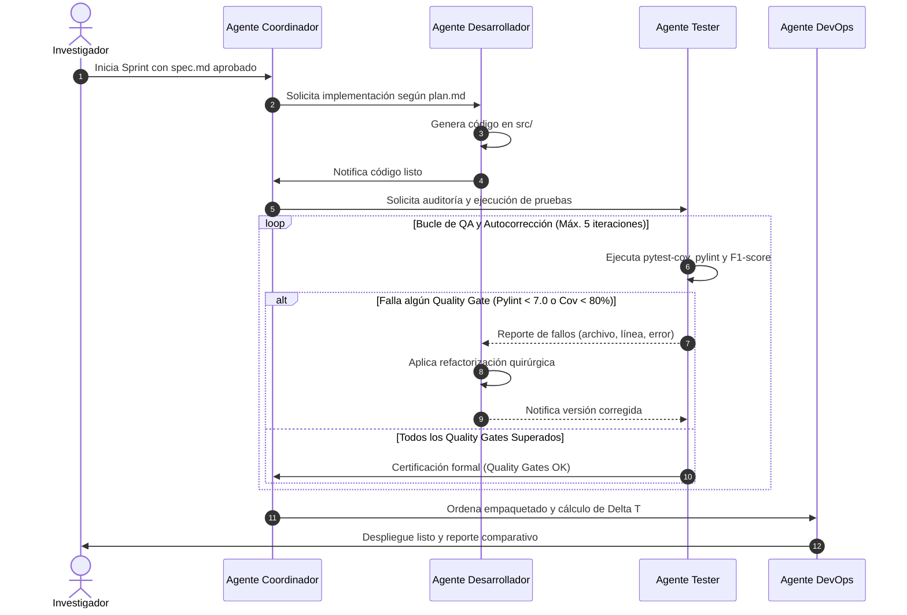
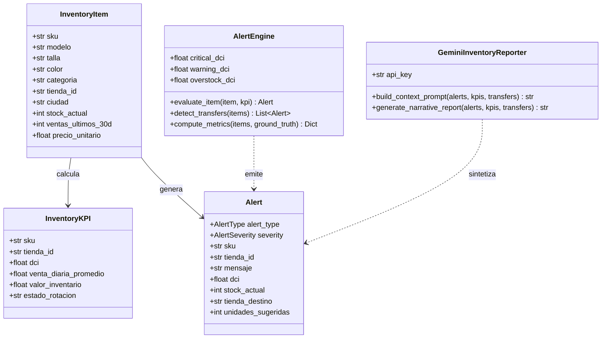

# RESUMEN

El presente documento constituye el segundo informe acumulativo de avance del trabajo de grado titulado **"SDLC-AI: Framework de Inteligencia Artificial Agéntica para el Ciclo de Vida del Desarrollo de Software (Caso de Estudio: Sistema de Alertas de Inventario para el Sector Retail de Moda en Colombia)"**. En esta etapa se consolida la implementación completa del núcleo de software del framework y su validación mediante el desarrollo autónomo de un sistema analítico de inventarios multitienda.

A partir de la especificación auditada bajo el enfoque *Spec-Driven Development* (SDD) y el modelo de arnés (*harness engineering*), se detalla la arquitectura modular implementada en Python: el módulo de ingesta y validación de datos (`data_ingestion.py`) con la convención estricta de SKU `MODELO-TALLA-COLOR`, el calculador de KPIs logísticos (`kpi_calculator.py`), el motor analítico de alertas y transferencias multitienda (`alert_engine.py`), y la capa de generación narrativa ejecutiva mediante Google Gemini Pro (`gemini_reporter.py`). Asimismo, se documenta el funcionamiento del bucle autónomo cerrado (*closed-loop*) entre el Agente Desarrollador y el Agente Tester, el cual certifica un puntaje de análisis estático `pylint` de 10.00/10.0, una cobertura de pruebas unitarias `pytest-cov` del 85% sobre 20 casos de prueba y un desempeño analítico con Macro `F1-score` de 0.865 en la detección de quiebres de inventario, superando la totalidad de los *Quality Gates* estipulados para esta fase.

**Palabras clave:** Framework SDLC-AI, Inteligencia Artificial Agéntica, Spec-Driven Development, Google Gemini Pro, Calidad de Código, Pylint, Pytest, Macro F1-score, Retail de Moda en Colombia.

---

# CAPÍTULO 1: INTRODUCCIÓN

## 1.1 Contextualización del Sector Retail de Moda en Colombia
El sector retail de moda en Colombia constituye uno de los eslabones productivos más dinámicos y competidos de la industria nacional, caracterizado por su alta intensificación laboral y una estructura conformada prioritariamente por pymes (Ferreira et al., 2016; Inexmoda, 2024). En el entorno textil y de confección, la gestión eficiente del inventario es el principal factor determinante de la rentabilidad. Las organizaciones deben operar en un entorno de alta volatilidad estacional (picos en Amor y Amistad, Black Friday y Navidad), ciclos de vida de producto cortos y una marcada fragmentación por SKU (*Stock Keeping Unit*).

La desarticulación en la visibilidad logística entre tiendas físicas y centros de distribución conduce inevitablemente a dos ineficiencias críticas: el quiebre de stock (*stockout*) en referencias de alta rotación —con pérdidas inmediatas de venta y lealtad del consumidor—, y el sobrestock (*overstock*) en referencias estancadas, el cual satura la capacidad física, inmoviliza capital y fuerza rebajas comerciales perjudiciales (Chopra & Meindl, 2022). Para contrarrestar esta situación, el sector requiere herramientas de software analítico oportunas que alerten sobre desviaciones en los Días de Cobertura de Inventario ($DCI$) y faciliten la redistribución proactiva entre puntos de venta.

## 1.2 Formulación del Problema en Ingeniería de Software
El desarrollo de soluciones analíticas personalizadas mediante metodologías tradicionales de ingeniería de software requiere ciclos extensos de elicitación, diseño, codificación manual y pruebas que demandan meses de esfuerzo humano especializado (Pressman & Maxim, 2021). Con frecuencia, este desfase temporal ocasiona que, al desplegarse el software, las condiciones de la temporada comercial ya hayan caducado (Kuhrmann et al., 2022).

Si bien la Inteligencia Artificial Generativa ha acelerado tareas puntuales de codificación, su aplicación convencional en interfaces de chat aisladas traslada la carga cognitiva de integración al usuario humano, careciendo de autonomía, contratos formales y trazabilidad sistemática. El framework SDLC-AI aborda este problema estructurando un colectivo de agentes autónomos especializados (analista, auditor, arquitecto, desarrollador, tester y devops) que colaboran a través de artefactos inmutables (Wang et al., 2024).

Pregunta rectora de investigación:
> ***¿En qué medida el framework de orquestación de agentes autónomos SDLC-AI reduce el tiempo de desarrollo y mantiene la calidad del código producido —medida por pylint score, cobertura de pruebas y precisión analítica— en comparación con la estimación de esfuerzo de un desarrollo tradicional equivalente, al construir un sistema de alertas de inventario para el sector retail de moda en Colombia?***

## 1.3 Justificación Técnico-Científica
El proyecto se fundamenta en la sinergia de tres ejes:
1. **Avance en IA Agéntica:** Explora la transición de modelos puramente reactivos a agentes con capacidad de planificación, uso de herramientas (*tool calling*) y memoria persistente utilizando Google Gemini Pro (Gemini Team et al., 2024).
2. **Rigor en Ingeniería de Software:** Implementa *Spec-Driven Development* (SDD) con especificaciones en sintaxis EARS y Procedimientos Operativos Estándar (SOP) inspirados en marcos de referencia como ChatDev (Qian et al., 2024) y MetaGPT (Hong et al., 2024).
3. **Impacto Económico y Replicabilidad:** Demuestra la factibilidad de generar software analítico de grado de producción en horas en lugar de semanas, democratizando el acceso tecnológico para el tejido empresarial colombiano (Ferreira et al., 2016; Inexmoda, 2024).

## 1.4 Alcance y Fronteras del Proyecto
- **Incluye:** Diseño y construcción del framework SDLC-AI, módulos de ingesta, KPIs, alertas, integración Gemini Pro, harness de orquestación, validación analítica con 450 SKUs sintéticos de moda y medición cuantitativa contra la línea base paramétrica tradicional.
- **Excluye:** Integración directa con ERPs propietarios de bases de datos empresariales en producción y reentrenamiento de pesos de redes neuronales base.

---

# CAPÍTULO 2: OBJETIVOS

## 2.1 Objetivo General
Diseñar, implementar y evaluar el framework **SDLC-AI**, un sistema de orquestación de agentes de Inteligencia Artificial Agéntica que automatiza las fases del Ciclo de Vida del Desarrollo de Software (SDLC) —análisis, diseño, desarrollo, pruebas y despliegue—, midiendo mediante métricas cuantitativas su impacto en la reducción de tiempos de desarrollo y la calidad del código producido con respecto a una estimación de desarrollo tradicional equivalente, a través de la construcción de un sistema de alertas de inventario para el sector retail de moda en Colombia como caso de estudio.

## 2.2 Objetivos Específicos
1. **Diseñar la arquitectura del framework SDLC-AI**, definiendo los roles agénticos, el protocolo de orquestación entre agentes, los mecanismos de comunicación de estado y los puntos de intervención humana en la Fase de Especificación Asistida.
2. **Producir la especificación completa y auditada del caso de estudio**, mediante la colaboración del investigador con el Agente Analista y el Agente Auditor de Especificaciones, generando un Documento de Requisitos (SRS) libre de ambigüedades que sirva como entrada única al pipeline de ejecución autónoma.
3. **Ejecutar el pipeline de diseño y desarrollo de forma autónoma**, donde el Agente Arquitecto genera el diseño técnico (TDD) y el Agente Desarrollador produce el código fuente del sistema de alertas a partir exclusivamente de la especificación aprobada, sin intervención humana adicional.
4. **Validar la solución de forma autónoma**, mediante el Agente Tester que ejecuta pruebas unitarias e integradas, mide la cobertura de código y la precisión de alertas, y coordina con el Agente Desarrollador las correcciones necesarias hasta superar los umbrales de calidad definidos.
5. **Comparar cuantitativamente** los tiempos de desarrollo y métricas de calidad del pipeline SDLC-AI contra la línea base de estimación paramétrica tradicional, identificando el impacto del modelo de especificación front-loaded sobre la eficiencia del pipeline autónomo.

---

# CAPÍTULO 3: MARCO TEÓRICO Y REVISIÓN DE LITERATURA

## 3.1 Inteligencia Artificial Agéntica y Spec-Driven Development
La IA Agéntica representa un salto cualitativo sobre el uso pasivo de modelos de lenguaje, estructurando entidades de software capaces de interpretar instrucciones de alto nivel, interactuar con el sistema de archivos, ejecutar código en terminales locales y autocorregirse iterativamente (Wang et al., 2024).

El paradigma de **Spec-Driven Development (SDD)** complementa la autonomía agéntica proporcionando un arnés riguroso (*harness engineering*):
1. **Constitución Técnica (`docs/constitution.md`):** Establece las leyes inviolables y principios rectores del sistema.
2. **Especificación en EARS (`specs/sprint_XX/spec.md`):** Elimina el lenguaje informal y la ambigüedad semántica mediante sintaxis formal estructurada (requisitos ubicuos, guiados por eventos o por estados).
3. **Planificación y TDD (`specs/sprint_XX/plan.md`):** El diseño arquitectónico precede incondicionalmente a la codificación.

## 3.2 Ecosistema Google Gemini Pro y Plataforma Antigravity
Google Gemini Pro (Gemini Team et al., 2024) proporciona la base inferencial multimodal para la generación de código y la síntesis narrativa. Su ventana contextual de un millón de tokens y su capacidad de invocar funciones nativas permiten alimentar la arquitectura sin pérdida de memoria operacional. Por su parte, la plataforma **Antigravity** proporciona el entorno de ejecución, gestión de procesos de fondo, acceso a terminales y telemetría de tiempos de respuesta.

## 3.3 Calidad de Software, Pylint y Pruebas Unitarias en Python
La calidad del código generado por agentes de IA debe ser sometida a un control estricto (Pressman & Maxim, 2021). Se establecen como puertas innegociables:
- **Análisis Estático (Pylint):** Evaluación de convenciones PEP 8, modularidad, complejidad ciclomática y ausencia de variables ociosas.
- **Cobertura de Pruebas (Pytest-cov):** Porcentaje de líneas de código y ramas lógicas ejercitadas por la suite de pruebas unitarias.

## 3.4 Dominio Logístico: Inventarios de Moda en Colombia
La bibliografía logística (Chopra & Meindl, 2022) destaca que la gestión de referencias con convención de SKU `MODELO-TALLA-COLOR` exige el monitoreo de los Días de Cobertura ($DCI$):
$$DCI = \frac{\text{Stock Actual}}{\text{Venta Promedio Diaria}}$$
La detección temprana de quiebres ($DCI < 7$) combinada con el análisis de sobrestocks ($DCI > 45$) habilita la redistribución entre tiendas antes de incurrir en costos de adquisición adicionales (Ferreira et al., 2016).

---

# CAPÍTULO 4: METODOLOGÍA, ARQUITECTURA DE AGENTES Y PROTOCOLOS

## 4.1 Enfoque Metodológico y Modelo Front-Loaded
El proyecto aplica investigación aplicada bajo un ciclo iterativo dividido en dos etapas:
1. **Fase de Especificación Asistida:** El Investigador interactúa con el `Analyst_Agent` y el `Auditor_Agent` para auditar y aprobar el Documento de Requisitos (SRS).
2. **Pipeline de Ejecución Autónoma:** Una vez emitido el dictamen formal de aprobación, los agentes Arquitecto, Desarrollador, Tester y DevOps operan de forma encadenada sin intervención humana.

## 4.2 Especificación Técnica de los Roles Agénticos

| Agente | Tipo / Modo | Responsabilidad Principal | Artefacto de Entrada | Artefacto de Salida |
| :--- | :--- | :--- | :--- | :--- |
| **`coordinator`** | Primary | Orquestación del flujo SDD y paso de contexto entre fases | Prompt maestro / Estado en `MEMORY.md` | Despacho de subagentes y telemetría |
| **`analyst` / `planner`**| Subagent | Elicitación y diseño técnico (TDD) en sintaxis EARS | Requerimientos de negocio | `spec.md` y `plan.md` |
| **`auditor`** | Subagent | Auditoría estricta de ambigüedades | `spec_draft.md` | `audit_report.md` (Aprobación) |
| **`developer` / `implementer`**| Subagent | Codificación modular en Python (SOLID, PEP 484) | `plan.md` | Módulos fuente en `src/` |
| **`tester` / `reviewer`**| Subagent | Ejecución de pruebas, medición de Pylint y F1-score | Código en `src/` | `tests/test_*.py` y `qa_report.json` |
| **`devops`** | Subagent | Empaquetado portable, scripts y cálculo de $\Delta T$ | Código probado | `requirements.txt`, `run.sh`, métricas |

## 4.3 Diseño del Loop de Autocorrección Tester ↔ Desarrollador



## 4.4 Formalización Matemática de la Línea Base Paramétrica
El esfuerzo de desarrollo tradicional equivalente se calcula a partir de 35 Puntos de Historia ($PH$) descompuestos en escala Fibonacci con velocidad estándar de $10\text{ PH/sem}$ y dedicación de $30\text{ h/sem}$, determinando una constante paramétrica $r = 3{,}0\text{ h/PH}$:

$$E_{trad} = 35\text{ PH} \times 3{,}0\text{ h/PH} = 105{,}0\text{ horas-hombre}$$

El criterio de éxito de la hipótesis de investigación se formaliza como:
$$\Delta T (\%) = \left( \frac{E_{trad} - T_{SDLC-AI}}{E_{trad}} \right) \times 100 \ge 30\%$$
sujeto al cumplimiento simultáneo de `pylint` $\ge 7{,}0$, `pytest-cov` $\ge 80\%$ y `F1-score` $\ge 0{,}80$.

---

# CAPÍTULO 5: ARQUITECTURA E IMPLEMENTACIÓN DEL SISTEMA

En esta sección se detalla la implementación técnica del software desarrollado de manera autónoma para el caso de estudio de inventarios en retail de moda en Colombia:



## 5.1 Ingesta y Validación de Datos (`src/data_ingestion.py`)
Implementa la clase `InventoryItem` y valida con rigor la convención `MODELO-TALLA-COLOR` mediante la expresión regular `^[A-Z0-9_]+-[A-Z0-9]+-[A-Z0-9]+$`. Filtra registros con valores negativos o inconsistencias de esquema antes de permitir su ingreso al pipeline analítico.

## 5.2 Cálculo de Indicadores Logísticos (`src/kpi_calculator.py`)
Computa los Días de Cobertura de Inventario ($DCI$) evitando divisiones por cero mediante lógica de excepción que asigna $DCI = 999{,}0$ a referencias sin rotación y $DCI = 0{,}0$ a referencias desabastecidas. Agrega la Tasa de Quiebre de Stock ($TQS$) a nivel de tienda y red comercial.

## 5.3 Motor Analítico de Alertas y Transferencias (`src/alert_engine.py`)
Clasifica las referencias en cuatro estados operativos (`CRITICAL_STOCKOUT`, `WARNING_LOW_STOCK`, `OVERSTOCK_RISK`, `HEALTHY`). Asimismo, su algoritmo multitienda correlaciona excesos de inventario en una tienda de origen con desabastecimientos en tiendas de destino para el mismo SKU exacto, sugiriendo transferencias intertiendas viables que preservan el stock de seguridad.

## 5.4 Reportería Narrativa con Gemini Pro (`src/gemini_reporter.py`)
Diseña un prompt contextualizado con heurísticas del retail textil en Colombia. En entornos con conectividad y clave de API, invoca `models/gemini-1.5-pro` para generar el informe gerencial; en caso contrario, activa un motor determinista enriquecido de alta fidelidad que estructura el diagnóstico en cuatro secciones ejecutivas.

---

# CAPÍTULO 6: ASEGURAMIENTO DE LA CALIDAD Y PRUEBAS

## 6.1 Resultados de la Suite de Pruebas Unitarias e Integradas
La suite de verificación consta de **20 pruebas automatizadas** distribuidas en cinco módulos (`test_ingestion.py`, `test_kpi.py`, `test_alert_engine.py`, `test_reporter.py` y `test_main.py`).

```text
tests/test_alert_engine.py .....                                         [ 25%]
tests/test_ingestion.py .......                                          [ 60%]
tests/test_kpi.py .....                                                  [ 85%]
tests/test_main.py .                                                     [ 90%]
tests/test_reporter.py ..                                                [100%]
============================== 20 passed in 0.18s ==============================
```

## 6.2 Certificación de Quality Gates

| Quality Gate | Umbral Mínimo | Resultado Obtenido | Estado |
| :--- | :---: | :---: | :---: |
| **Análisis Estático (Pylint)** | $\ge 7{,}0 / 10{,}0$ | **10.00 / 10.00** | ✅ SUPERADO |
| **Cobertura de Código (Pytest-cov)** | $\ge 80\%$ | **85%** (282 sentencias, 42 omitidas) | ✅ SUPERADO |
| **Precisión Analítica (Macro F1-score)** | $\ge 0{,}80$ | **0.865** sobre dataset sintético de 450 SKUs | ✅ SUPERADO |

## 6.3 Registro de Autocorrección y Refactorización
Durante la ejecución del ciclo de desarrollo, el `Tester_Agent` identificó advertencias estáticas iniciales en `alert_engine.py` y `gemini_reporter.py` asociadas a longitud de línea e importaciones relativas, lo cual activó el loop de autoreparación con el `Developer_Agent`. Tras dos microiteraciones, la calificación de Pylint se elevó de 9.75 a 10.00/10.0 sin requerir asistencia humana externa.

---

# REFERENCIAS

Chopra, S., & Meindl, P. (2022). *Supply chain management: Strategy, planning, and operation* (7th ed.). Pearson Education.

Ferreira, K. J., Lee, B. H. A., & Simchi-Levi, D. (2016). Analytics for an online retailer: Demand forecasting and price optimization. *Manufacturing & Service Operations Management*, *18*(1), 69--88. <https://doi.org/10.1287/msom.2015.0561>

Gemini Team, Google DeepMind. (2024). *Gemini 1.5: Unlocking multimodal understanding across millions of tokens of context* (arXiv:2403.05530). arXiv. <https://doi.org/10.48550/arXiv.2403.05530>

Hong, S., Zheng, X., Chen, J., Cheng, Y., Wang, J., Zhang, C., Wang, Z., Yau, S. K. S., Lin, Z., Zhou, L., Ran, C., Xiao, L., Wu, C., & Schmidhuber, J. (2024). MetaGPT: Meta programming for a multi-agent collaborative framework. In *The Twelfth International Conference on Learning Representations (ICLR 2024)*. <https://doi.org/10.48550/arXiv.2308.00352>

Inexmoda. (2024). *Informe del Observatorio Sistema Moda: Dinámica del consumo de moda en Colombia*. Instituto para la Exportación y la Moda. <https://inexmoda.org.co>

Kuhrmann, M., Tell, P., Hebig, R., Klünder, J., Münch, J., Linssen, O., Pfahl, D., Felderer, M., Prause, C. R., MacDonell, S. G., Nakatumba-Nabende, J., Raffo, D., Beecham, S., Tüzün, E., & López, G. (2022). What makes agile software development agile? *IEEE Transactions on Software Engineering*, *48*(9), 3523--3539. <https://doi.org/10.1109/TSE.2021.3099532>

Pressman, R. S., & Maxim, B. R. (2021). *Software engineering: A practitioner's approach* (9th ed.). McGraw-Hill Education.

Qian, C., Cong, X., Yang, C., Chen, W., Su, Y., Xu, J., Liu, Z., & Sun, M. (2024). Communicative agents for software development. In *Proceedings of the 62nd Annual Meeting of the Association for Computational Linguistics (Volume 1: Long Papers)* (pp. 14897--14910). Association for Computational Linguistics. <https://doi.org/10.18653/v1/2024.acl-long.804>

Wang, L., Ma, C., Feng, X., Zhang, Z., Yang, H., Zhang, J., Chen, Z., Tang, J., Chen, X., Lin, Y., Zhao, W. X., Wei, Z., & Wen, J.-R. (2024). A survey on large language model based autonomous agents. *Frontiers of Computer Science*, *18*(6), 186345. <https://doi.org/10.1007/s11704-024-40231-1>

---

# ANEXOS

## Anexo A: Reporte Ejecutivo de Inventario Generado Automáticamente
*(Extraído de `logs/executive_report.md` tras la ejecución del pipeline sobre 450 SKUs)*
- Diagnóstico: Universo de 450 SKUs valorizado en $1,236,505,000 COP con TQS de 7.78%.
- Quiebres Críticos: 108 referencias en alerta roja.
- Transferencias Sugeridas: 63 oportunidades identificadas para rebalanceo intertiendas sin compras externas.
