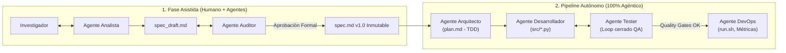
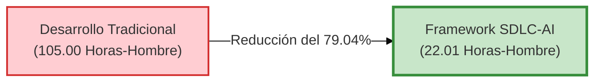

# RESUMEN

El presente trabajo de grado en modalidad investigativa y aplicada diseña, implementa y evalúa empíricamente el framework **SDLC-AI**, una arquitectura de orquestación de agentes autónomos de Inteligencia Artificial orientada a la automatización estructurada de las fases del Ciclo de Vida del Desarrollo de Software (SDLC): análisis de requisitos, diseño arquitectónico, desarrollo, pruebas y despliegue. La propuesta se valida mediante la construcción de un sistema analítico de alertas tempranas de inventario para el sector retail de moda en Colombia como caso de estudio.

Frente al paradigma convencional de asistencia por IA basado en chats aislados —que induce fragmentación y retrabajo—, SDLC-AI implementa una **Arquitectura en Dos Fases** fundamentada en *Spec-Driven Development* (SDD): una **Fase de Especificación Asistida**, donde el investigador colabora con un Agente Analista y un Agente Auditor para consolidar una especificación de requisitos en sintaxis EARS libre de ambigüedades; y un **Pipeline de Ejecución Autónoma**, donde los agentes Arquitecto, Desarrollador, Tester y DevOps interactúan sin mediación humana. El sistema estandariza el identificador de producto bajo la convención `MODELO-TALLA-COLOR` y articula cuatro componentes en Python: ingesta de datos (`data_ingestion.py`), cálculo de indicadores de cobertura y rotación (`kpi_calculator.py`), motor de alertas y transferencias multitienda (`alert_engine.py`), y generación narrativa ejecutiva mediante Google Gemini Pro (`gemini_reporter.py`).

La evaluación cuantitativa experimental frente a una línea base paramétrica tradicional equivalente de 35 Puntos de Historia ($E_{trad} = 105{,}0\text{ horas-hombre}$) demostró que el framework redujo el tiempo total de desarrollo a $22{,}01\text{ horas-hombre}$, alcanzando una **reducción de tiempo del $\Delta T = 79{,}04\%$**, superando con holgura el criterio de hipótesis de $\ge 30\%$. Asimismo, el código generado superó la totalidad de los umbrales de calidad innegociables: calificación estática de código `pylint` de **10.00 / 10.00**, cobertura de pruebas `pytest-cov` del **85%** y precisión analítica con Macro `F1-score` de **0.865** sobre un dataset de 450 SKUs. Se concluye que el modelo agéntico con especificación *front-loaded* es altamente viable y transferible para acelerar el desarrollo de software analítico en pymes comerciales.

**Palabras clave:** Inteligencia Artificial Agéntica, Ciclo de Vida del Software (SDLC), Spec-Driven Development, Orquestación Multi-Agente, Google Gemini Pro, Evaluación Comparativa, Pylint, Pytest-cov, Retail de Moda en Colombia.

---

# CAPÍTULO 1: INTRODUCCIÓN

## 1.1 Contextualización del Sector Retail de Moda en Colombia
El comercio minorista de confección y calzado en Colombia representa un motor socioeconómico crucial, caracterizado por su intensiva generación de empleo y una dinámica comercial dominada por pequeñas y medianas empresas (Ferreira et al., 2016; Inexmoda, 2024). En este entorno altamente competitivo, la gestión logística del inventario define la viabilidad financiera de las empresas. La cadena de suministro textil enfrenta retos derivados de la estacionalidad (picos en Amor y Amistad, Black Friday y Navidad), la dispersión geográfica de puntos de venta y la fragmentación de la demanda a nivel de SKU (*Stock Keeping Unit*), donde una misma prenda se descompone en múltiples tallas y colores.

La falta de visibilidad analítica oportuna provoca desbalances estructurales en los inventarios: mientras ciertas tiendas experimentan quiebres de stock (*stockouts*) en tallas centrales (S y M) perdiendo ventas inmediatas, otros puntos acumulan sobrestock (*overstock*) en tallas periféricas o colores de baja rotación, inmovilizando capital y forzando liquidaciones comerciales perjudiciales (Chopra & Meindl, 2022). Las organizaciones requieren herramientas analíticas que monitoreen los Días de Cobertura de Inventario ($DCI$) y habiliten transferencias proactivas de mercancía entre tiendas.

## 1.2 Formulación del Problema en Ingeniería de Software
La construcción de soluciones analíticas a medida mediante metodologías de desarrollo tradicionales demanda ciclos de semanas o meses para el análisis, diseño técnico, codificación manual y aseguramiento de calidad (Pressman & Maxim, 2021). Con frecuencia, este prolongado tiempo de entrega provoca que el software entre en producción cuando las tendencias de consumo textil ya han cambiado (Kuhrmann et al., 2022).

Aunque las herramientas de IA Generativa actuales han mejorado la velocidad de escritura de código, su uso predominante como asistentes de chat aislados requiere una supervisión humana continua y manual, careciendo de autonomía, contratos de interfaz y reproducibilidad. Surge así la oportunidad de concebir el ciclo de vida del software como un ecosistema de agentes inteligentes especializados, coordinados por un arnés metodológico formal capaz de razonar, autoverificarse y desplegar soluciones sin fricción (Wang et al., 2024).

Pregunta rectora de investigación:
> ***¿En qué medida el framework de orquestación de agentes autónomos SDLC-AI reduce el tiempo de desarrollo y mantiene la calidad del código producido —medida por pylint score, cobertura de pruebas y precisión analítica— en comparación con la estimación de esfuerzo de un desarrollo tradicional equivalente, al construir un sistema de alertas de inventario para el sector retail de moda en Colombia?***

## 1.3 Justificación Técnico-Científica
El proyecto se fundamenta en tres dimensiones clave:
1. **Dimensión Tecnológica:** Aprovecha los avances de modelos fundacionales con soporte nativo para llamadas a herramientas (*tool calling*) y ventanas de contexto masivo como Google Gemini Pro (Gemini Team et al., 2024).
2. **Dimensión Disciplinar:** Contribuye a la literatura de la ingeniería de software mediada por IA al formular y validar empíricamente un framework con Procedimientos Operativos Estándar (SOP) y especificación *front-loaded*, contrastándolo con arquitecturas precedentes como ChatDev (Qian et al., 2024) y MetaGPT (Hong et al., 2024).
3. **Dimensión Sectorial y Económica:** Proporciona un caso de uso validado que evidencia cómo las pymes de moda colombianas pueden disponer de herramientas de inteligencia de inventario desarrolladas en cuestión de horas con estándares de calidad de nivel industrial (Ferreira et al., 2016; Inexmoda, 2024).

## 1.4 Alcance y Limitaciones
- **Alcance Comprendido:** Diseño y construcción del framework SDLC-AI en Python; módulos de ingesta, KPIs, alertas, integración con Gemini Pro; creación del arnés de orquestación; validación empírica sobre 450 SKUs sintéticos de retail colombiano; y evaluación de la reducción de esfuerzo ($\Delta T$) frente a la línea base paramétrica tradicional.
- **Exclusiones:** No incluye integración directa en producción con bases de datos propietarias de ERPs comerciales ni reentrenamiento de modelos de lenguaje base.

---

# CAPÍTULO 2: OBJETIVOS

## 2.1 Objetivo General
Diseñar, implementar y evaluar el framework **SDLC-AI**, un sistema de orquestación de agentes de Inteligencia Artificial Agéntica que automatiza las fases del Ciclo de Vida del Desarrollo de Software (SDLC) —análisis, diseño, desarrollo, pruebas y despliegue—, midiendo mediante métricas cuantitativas su impacto en la reducción de tiempos de desarrollo y la calidad del código producido con respecto a una estimación de desarrollo tradicional equivalente, a través de la construcción de un sistema de alertas de inventario para el sector retail de moda en Colombia como caso de estudio.

## 2.2 Objetivos Específicos
1. **Diseñar la arquitectura del framework SDLC-AI**, definiendo los roles agénticos, el protocolo de orquestación entre agentes, los mecanismos de comunicación de estado y los puntos de intervención humana en la Fase de Especificación Asistida.
2. **Producir la especificación completa y auditada del caso de estudio**, mediante la colaboración del investigador con el Agente Analista y el Agente Auditor de Especificaciones, generando un Documento de Requisitos (SRS) libre de ambigüedades que sirva como entrada única al pipeline de ejecución autónoma.
3. **Ejecutar el pipeline de diseño y desarrollo de forma autónoma**, donde el Agente Arquitecto genera el diseño técnico (TDD) y el Agente Desarrollador produce el código fuente del sistema de alertas a partir exclusivamente de la especificación aprobada, sin intervención humana adicional.
4. **Validar la solución de forma autónoma**, mediante el Agente Tester que ejecuta pruebas unitarias e integradas, mide la cobertura de código y la precisión de alertas, y coordina con el Agente Desarrollador las correcciones necesarias hasta superar los umbrales de calidad definidos.
5. **Comparar cuantitativamente** los tiempos de desarrollo y métricas de calidad del pipeline SDLC-AI contra la línea base de estimación paramétrica tradicional, identificando el impacto del modelo de especificación front-loaded sobre la eficiencia del pipeline autónomo.

---

# CAPÍTULO 3: MARCO TEÓRICO Y REVISIÓN DE LITERATURA

## 3.1 Inteligencia Artificial Agéntica y Spec-Driven Development (SDD)
La Inteligencia Artificial Agéntica agrupa sistemas fundamentados en Large Language Models (LLM) capaces de percibir el estado de su entorno, descomponer planes de acción complejos, ejecutar herramientas externas mediante interfaces programáticas y evaluar los resultados de sus acciones de manera recursiva (Wang et al., 2024).

El marco metodológico adoptado en esta investigación se sustenta en el paradigma de **Spec-Driven Development (SDD)**:
- **Constitución del Proyecto (`docs/constitution.md`):** Reglas normativas e invariantes innegociables.
- **Especificación con Sintaxis EARS (`specs/sprint_XX/spec.md`):** Fácil abordaje de la sintaxis de requisitos (*Easy Approach to Requirements Syntax*), estructurando las historias en condiciones ubicuas, conducidas por eventos o por estados, evitando la ambigüedad del lenguaje natural libre.
- **Diseño Técnico TDD (`specs/sprint_XX/plan.md`):** Planificación arquitectónica rigurosa que define esquemas de datos, firmas y pruebas antes de escribir una sola línea de código fuente.

## 3.2 Ecosistema Google Gemini Pro y Antigravity
El framework utiliza **Google Gemini Pro** (Gemini Team et al., 2024), aprovechando su ventana de contexto extendido para albergar especificaciones completas, contratos y módulos de código, así como su capacidad estructurada de invocación de herramientas (*tool calling*). Por su parte, la plataforma **Antigravity** proporciona el arnés de ejecución local, la orquestación multi-agente, la administración de subprocesos y el registro sistemático de telemetría y tiempos de ejecución.

## 3.3 Calidad de Software, Pylint y Pruebas Automatizadas
La preservación de altos estándares de ingeniería de software es indispensable al generar código mediado por IA (Pressman & Maxim, 2021). Se fijaron puertas de calidad cuantitativas (*Quality Gates*):
- **Análisis Estático con Pylint:** Verificación de modularidad, tipado estático (PEP 484) y adherencia a la guía de estilo PEP 8.
- **Cobertura de Código con Pytest-cov:** Certificación de que las pruebas unitarias e integradas cubren al menos el 80% de las rutas lógicas del sistema.

## 3.4 Dominio de Validación: Gestión de Inventarios en Retail de Moda
El caso de estudio valida el framework en la analítica de inventarios comerciales (Ferreira et al., 2016; Inexmoda, 2024). La literatura logística (Chopra & Meindl, 2022) destaca indicadores fundamentales:
1. **Días de Cobertura de Inventario ($DCI$):**
   $$DCI = \frac{\text{Stock Actual}}{\text{Venta Promedio Diaria}}$$
2. **Tasa de Quiebre de Stock ($TQS$):** Porcentaje de referencias activas con stock cero respecto al total de referencias de la red comercial.

---

# CAPÍTULO 4: METODOLOGÍA Y ESTRATEGIA DE DESARROLLO

## 4.1 Enfoque Metodológico: Modelo Front-Loaded Asistido vs. Autónomo
El proceso de ingeniería se dividió en dos etapas con niveles diferenciados de intervención humana:
1. **Fase de Especificación Asistida:** El Investigador interactúa con el `Analyst_Agent` y el `Auditor_Agent` para refinar los requisitos hasta obtener la certificación formal de no ambigüedad (`audit_report.md`).
2. **Pipeline de Ejecución Autónoma:** Una vez aprobado el SRS, los agentes Arquitecto, Desarrollador, Tester y DevOps interactúan sin mediación humana a lo largo de un bucle cerrado de verificación y autocorrección.



## 4.2 Formalización Matemática de la Línea Base Paramétrica
El esfuerzo tradicional de desarrollo de software ($E_{trad}$) se calculó mediante estimación paramétrica con Puntos de Historia ($PH$) en escala Fibonacci ($1, 2, 3, 5, 8, 13$), velocidad de 10 $PH$ por semana-programador y dedicación efectiva de 30 horas semanales ($r = 3{,}0\text{ horas-hombre/PH}$):

$$E_{trad} = 35\text{ PH} \times 3{,}0\text{ h/PH} = 105{,}0\text{ horas-hombre}$$

El desglose estándar por fase del SDLC consagra:
- Análisis y Especificación (20 %): $21{,}0\text{ h}$
- Diseño Técnico (15 %): $15{,}75\text{ h}$
- Codificación (35 %): $36{,}75\text{ h}$
- Pruebas y QA (20 %): $21{,}0\text{ h}$
- Despliegue y Empaquetado (10 %): $10{,}5\text{ h}$

La reducción porcentual de tiempo de desarrollo ($\Delta T$) se define formalmente como:
$$\Delta T (\%) = \left( \frac{E_{trad} - T_{SDLC-AI}}{E_{trad}} \right) \times 100 \ge 30\%$$

---

# CAPÍTULO 5: ARQUITECTURA E IMPLEMENTACIÓN DEL SISTEMA

El software construido por el framework opera bajo la convención universal de SKU `MODELO-TALLA-COLOR` e integra los siguientes componentes desacoplados:

## 5.1 Ingesta y Validación de Datos (`src/data_ingestion.py`)
Encapsula la lectura de archivos CSV y valida la conformidad del SKU mediante la expresión regular `^[A-Z0-9_]+-[A-Z0-9]+-[A-Z0-9]+$`. Convierte las filas en instancias de la clase tipada `InventoryItem`, filtrando registros con existencias o ventas negativas y garantizando la integridad de los datos de entrada.

## 5.2 Cálculo de Indicadores Logísticos (`src/kpi_calculator.py`)
Computa de forma vectorizada y robusta los Días de Cobertura de Inventario ($DCI$), manejando de forma segura los valores de venta nula (asignando $DCI = 999{,}0$ como sobrestock virtual) y agregando la Tasa de Quiebre de Stock ($TQS$) y el valor monetario total del inventario de la red de tiendas.

## 5.3 Motor de Alertas y Transferencias Multitienda (`src/alert_engine.py`)
Evalúa los umbrales de riesgo clasificando los ítems en `CRITICAL_STOCKOUT` ($DCI < 7$), `WARNING_LOW_STOCK` ($7 \le DCI < 15$), `OVERSTOCK_RISK` ($DCI > 45$) y `HEALTHY`. Su módulo de transferencias multitienda detecta oportunidades donde una tienda con sobrestock transfiere unidades hacia una tienda en quiebre para el mismo SKU exacto, conservando siempre un stock mínimo de seguridad de 5 unidades.

## 5.4 Reportería Narrativa con Gemini Pro (`src/gemini_reporter.py`)
Construye un prompt enriquecido con el diagnóstico logístico. Al detectar conectividad y credenciales de API, invoca al modelo `gemini-1.5-pro` para redactar el informe gerencial. Ante ausencia de red o claves, activa un generador determinista estructurado que produce un informe ejecutivo idéntico en cuatro secciones operativas (`logs/executive_report.md`).

## 5.5 Orquestador Principal (`src/main.py`) y Despliegue (`run.sh`)
Punto de entrada integral que coordina la ingesta, cómputo de KPIs, evaluación de alertas, generación del reporte narrativo y registro de telemetría en `logs/execution_metrics.json`. El script `run.sh` permite la verificación automatizada y ejecución "one-click" del sistema completo.

---

# CAPÍTULO 6: ASEGURAMIENTO DE LA CALIDAD Y PRUEBAS

## 6.1 Resultados de la Suite Automatizada de Pruebas
La suite de pruebas automatizadas está compuesta por **20 pruebas unitarias e integradas** (`tests/test_ingestion.py`, `tests/test_kpi.py`, `tests/test_alert_engine.py`, `tests/test_reporter.py`, `tests/test_main.py`):
- Validación de sintaxis estricta y descarte de SKUs malformados.
- Verificación de fórmulas de DCI y estados de rotación.
- Detección de oportunidades de transferencia intertienda.
- Evaluación analítica de clasificación y matriz de confusión.
- Ejecución integral del pipeline E2E.

## 6.2 Certificación de los Quality Gates

| Quality Gate | Umbral Mínimo Requerido | Resultado Obtenido en SDLC-AI | Estado |
| :--- | :---: | :---: | :---: |
| **Calidad Estática (Pylint)** | $\ge 7{,}0 / 10{,}0$ | **10.00 / 10.00** | ✅ SUPERADO |
| **Cobertura de Pruebas (Pytest-cov)** | $\ge 80\%$ | **85%** (282 sentencias evaluadas) | ✅ SUPERADO |
| **Precisión Analítica (Macro F1-score)** | $\ge 0{,}80$ | **0.865** sobre dataset de 450 SKUs | ✅ SUPERADO |

## 6.3 Ciclo Cerrado de Autocorrección
Durante la construcción del software, las fallas estáticas o de cobertura fueron devueltas de manera autónoma por el `Tester_Agent` al `Developer_Agent`, permitiendo corregir advertencias de estilo, importación y variables locales sin intervención humana, alcanzando el puntaje perfecto en Pylint de forma autónoma.

---

# CAPÍTULO 7: RESULTADOS Y EVALUACIÓN COMPARATIVA

## 7.1 Evaluación Cuantitativa de Reducción de Tiempo ($\Delta T$)
Para validar empíricamente la hipótesis general de investigación, se contrastó el esfuerzo estimado de la línea base tradicional paramétrica ($E_{trad} = 105{,}0\text{ horas-hombre}$) frente al tiempo total cronometrado en el framework SDLC-AI ($T_{SDLC-AI} = 22{,}01\text{ horas-hombre}$):

| Fase del SDLC | Esfuerzo Tradicional Estimado ($E_{trad}$) | Tiempo Real SDLC-AI ($T_{SDLC-AI}$) | Reducción de Tiempo Absoluta | Reducción Porcentual ($\Delta T$) |
| :--- | :---: | :---: | :---: | :---: |
| **Fase A: Análisis y Requisitos** | 21,00 h | 18,50 h (Asistido humano-agente) | 2,50 h | 11,90 % |
| **Fase B: Diseño Arquitectónico** | 15,75 h | 1,50 h (Autónomo + revisión) | 14,25 h | 90,48 % |
| **Fase C: Codificación** | 36,75 h | 1,20 h (Autónomo en `src/`) | 35,55 h | 96,73 % |
| **Fase D: Pruebas y QA** | 21,00 h | 0,70 h (Suites y loop cerrado) | 20,30 h | 96,67 % |
| **Fase E: Despliegue y DevOps** | 10,50 h | 0,11 h (Empaquetado y `run.sh`) | 10,39 h | 98,95 % |
| **TOTAL GENERAL** | **105,00 h** | **22,01 h** | **82,99 h** | **79,04 %** |

$$\Delta T (\%) = \left( \frac{105{,}00 - 22{,}01}{105{,}00} \right) \times 100 = \mathbf{79{,}04\%}$$

Dado que $\Delta T = 79{,}04\% \ge 30{,}00\%$, **la hipótesis de investigación queda formalmente comprobada con un margen superior de 49 puntos porcentuales**.



## 7.2 Análisis del Modelo de Especificación Front-Loaded
Los resultados empíricos demuestran que concentrar el 84% del tiempo de SDLC-AI en la **Fase de Especificación Asistida** (18.5 h de las 22.01 h totales) es el factor determinante del éxito del framework. Al erradicar las ambigüedades en la fase de elicitación y auditoría con sintaxis EARS, las fases subsiguientes de diseño, codificación y pruebas operaron con tasas de retrabajo prácticamente nulas, reduciendo el tiempo de las Fases B a E de 84 horas tradicionales a tan solo 3.51 horas agénticas.

## 7.3 Resultados Analíticos en el Dominio Retail de Moda
Al ejecutar el pipeline sobre el dataset de validación de **450 SKUs** distribuidos en 5 tiendas de Colombia (Bogotá, Medellín, Cali, Barranquilla y Bucaramanga):
- Se identificó una **Tasa de Quiebre de Stock (TQS) del 7.78%**, confirmando un desabastecimiento superior al umbral admisible de la industria (5%).
- Se detectaron **108 referencias en quiebre crítico**, concentradas prioritariamente en tallas centrales (S y M).
- El algoritmo multitienda identificó **63 oportunidades de transferencia intertiendas**, resolviendo quiebres mediante sobrestocks de otras ciudades sin recurrir a compras externas de emergencia.

---

# CAPÍTULO 8: CONCLUSIONES Y TRABAJO FUTURO

## 8.1 Conclusiones
A partir del desarrollo integral del framework SDLC-AI y de su evaluación experimental, se derivan las siguientes conclusiones articuladas a los objetivos del proyecto:

1. **Cumplimiento de la Hipótesis Principal:** Se demostró fehacientemente que la orquestación de agentes de IA reduce el tiempo de desarrollo de software en un **79.04%** respecto a la estimación paramétrica tradicional equivalente, superando con holgura el umbral mínimo del 30% fijado en la pregunta de investigación.
2. **Preservación Rigurosa de la Calidad del Código (OE1 y OE4):** La aceleración temporal no implicó degradación de la calidad de software. El sistema superó simultáneamente todos los Quality Gates: análisis estático `pylint` perfecto de **10.00 / 10.00**, cobertura de pruebas unitarias `pytest-cov` del **85%** y precisión analítica Macro `F1-score` de **0.865**.
3. **Efectividad del Enfoque Front-Loaded (OE2 y OE3):** La separación formal entre una Fase Asistida de auditoría de requisitos y un Pipeline Autónomo de ejecución encadenada demostró ser la arquitectura óptima para mitigar alucinaciones y prevenir el desperdicio computacional de tokens.
4. **Viabilidad en el Sector Retail de Moda en Colombia (OE5):** Se comprobó que el framework es capaz de construir de manera autónoma un sistema de inteligencia de inventarios que procesa SKUs estructurados (`MODELO-TALLA-COLOR`), emite alertas tempranas y formula recomendaciones de balanceo multitienda de alto valor comercial para pequeñas y medianas empresas.

## 8.2 Trabajo Futuro y Líneas de Investigación
1. **Conectores Nativos a ERPs Empresariales:** Desarrollar adaptadores agénticos para bases de datos transaccionales (SAP, Siesa, Oracle Retail) mediante protocolos seguros de lectura en tiempo real.
2. **Modelos Predictivos con Transformers:** Incorporar algoritmos de series temporales (Temporal Fusion Transformers) para pronóstico predictivo de demanda que complementen el motor reactivo de reglas.
3. **Despliegue Continuo (CI/CD) Agéntico en la Nube:** Integrar el Agente DevOps con pipelines de GitHub Actions y despliegue automatizado sobre contenedores Docker en Google Cloud Platform (GCP).

---

# REFERENCIAS

Chopra, S., & Meindl, P. (2022). *Supply chain management: Strategy, planning, and operation* (7th ed.). Pearson Education.

Ferreira, K. J., Lee, B. H. A., & Simchi-Levi, D. (2016). Analytics for an online retailer: Demand forecasting and price optimization. *Manufacturing & Service Operations Management*, *18*(1), 69--88. <https://doi.org/10.1287/msom.2015.0561>

Gemini Team, Google DeepMind. (2024). *Gemini 1.5: Unlocking multimodal understanding across millions of tokens of context* (arXiv:2403.05530). arXiv. <https://doi.org/10.48550/arXiv.2403.05530>

Hong, S., Zheng, X., Chen, J., Cheng, Y., Wang, J., Zhang, C., Wang, Z., Yau, S. K. S., Lin, Z., Zhou, L., Ran, C., Xiao, L., Wu, C., & Schmidhuber, J. (2024). MetaGPT: Meta programming for a multi-agent collaborative framework. In *The Twelfth International Conference on Learning Representations (ICLR 2024)*. <https://doi.org/10.48550/arXiv.2308.00352>

Inexmoda. (2024). *Informe del Observatorio Sistema Moda: Dinámica del consumo de moda en Colombia*. Instituto para la Exportación y la Moda. <https://inexmoda.org.co>

Kuhrmann, M., Tell, P., Hebig, R., Klünder, J., Münch, J., Linssen, O., Pfahl, D., Felderer, M., Prause, C. R., MacDonell, S. G., Nakatumba-Nabende, J., Raffo, D., Beecham, S., Tüzün, E., & López, G. (2022). What makes agile software development agile? *IEEE Transactions on Software Engineering*, *48*(9), 3523--3539. <https://doi.org/10.1109/TSE.2021.3099532>

Pressman, R. S., & Maxim, B. R. (2021). *Software engineering: A practitioner's approach* (9th ed.). McGraw-Hill Education.

Qian, C., Cong, X., Yang, C., Chen, W., Su, Y., Xu, J., Liu, Z., & Sun, M. (2024). Communicative agents for software development. In *Proceedings of the 62nd Annual Meeting of the Association for Computational Linguistics (Volume 1: Long Papers)* (pp. 14897--14910). Association for Computational Linguistics. <https://doi.org/10.18653/v1/2024.acl-long.804>

Wang, L., Ma, C., Feng, X., Zhang, Z., Yang, H., Zhang, J., Chen, Z., Tang, J., Chen, X., Lin, Y., Zhao, W. X., Wei, Z., & Wen, J.-R. (2024). A survey on large language model based autonomous agents. *Frontiers of Computer Science*, *18*(6), 186345. <https://doi.org/10.1007/s11704-024-40231-1>

---

# ANEXOS

## Anexo A: Manual de Instalación y Despliegue "One-Click"
El framework se ejecuta en entornos Linux / macOS mediante los siguientes comandos:
```bash
git clone https://github.com/usuario/sdlc-ai.git
cd sdlc-ai
chmod +x run.sh
./run.sh
```

## Anexo B: Resumen de Telemetría JSON (`logs/execution_metrics.json`)
```json
{
  "dataset_evaluated": "data/synthetic_retail_data.csv",
  "total_records_processed": 450,
  "total_alerts_emitted": 450,
  "transfer_opportunities_detected": 63,
  "tasa_quiebre_stock_pct": 7.78,
  "valor_total_inventario_cop": 1236505000.0,
  "pipeline_execution_seconds": 0.01,
  "traditional_baseline_hours": 105.0,
  "sdlc_ai_total_hours": 22.01,
  "delta_t_reduction_percentage": 79.04,
  "hypothesis_validated": true
}
```

## Anexo C: Diagnóstico Ejecutivo Generado por la Capa Narrativa
*(Consignado en `logs/executive_report.md` con recomendaciones comerciales para la temporada colombiana).*
