# CONSTITUCIÓN TÉCNICA Y NORMATIVA DEL FRAMEWORK SDLC-AI

## 1. PREÁMBULO, IDENTIDAD Y GOBERNANZA
El presente documento constituye la **Constitución Técnica Inmutable** del proyecto de investigación aplicada y trabajo de grado en Ingeniería de Software:

- **Título Oficial:** *SDLC-AI: Framework de Inteligencia Artificial Agéntica para el Ciclo de Vida del Desarrollo de Software (Caso de Estudio: Sistema de Alertas de Inventario para el Sector Retail de Moda en Colombia)*.
- **Investigador Líder:** Miguel Ángel Fajardo Cossio (C.C. 1234990751).
- **Asesor Metodológico y Temático:** Wilson Eduardo Soto Forero.
- **Institución:** Politécnico Grancolombiano — Facultad de Ingeniería, Diseño e Innovación (FIDI) / Departamento de Ingeniería de Software.
- **Línea Base Documental Aprobada:** `SDLC-AI_Anteproyecto_v4.md`. Las definiciones metodológicas, objetivos y fórmulas matemáticas contenidas en dicha versión son de cumplimiento obligatorio e inalterable.

---

## 2. PRINCIPIOS INVIOLABLES DE ARQUITECTURA E INGENIERÍA

### Principio 1: Separación de Fases Asistida vs. Autónoma
1. **Fase de Especificación Asistida (Etapa 1 - Fase A):** Es el único espacio del SDLC donde existe interacción humana activa. El Investigador colabora con el **Agente Analista** para la elicitación de requisitos y con el **Agente Auditor de Especificaciones** para la detección y mitigación de ambigüedades.
2. **Pipeline de Ejecución Autónoma (Etapa 2 - Fases B, C, D y E):** Una vez aprobado el Documento de Requisitos de Software (`specs/sprint_XX/spec.md`) con el aval explícito de auditoría (`specs/sprint_XX/audit_report.md`), los agentes Arquitecto, Desarrollador, Tester y DevOps ejecutan las fases técnicas de manera encadenada y autónoma sin intervención humana.

### Principio 2: Especificación Front-Loaded (Calidad en el Origen)
Ningún agente del pipeline autónomo comenzará tareas de diseño, codificación o pruebas sin que el SRS de la iteración posea el dictamen formal: `STATUS: APPROVED` por parte del Agente Auditor. El modelo penaliza y previene el retrabajo en etapas posteriores concentrando el esfuerzo en la completitud de la especificación inicial.

### Principio 3: Puertas de Calidad Cuantitativas Innegociables (Quality Gates)
Todo incremento funcional de software que se aspire a integrar en el repositorio debe superar obligatoriamente los cuatro umbrales cuantitativos:
1. **Calidad Estática de Código:** `pylint score >= 7.0 / 10.0` en cada módulo dentro del directorio `src/`.
2. **Cobertura de Pruebas Automatizadas:** `pytest-cov >= 80%` en la suite de pruebas unitarias e integradas (`tests/`).
3. **Efectividad Analítica del Algoritmo:** `F1-score >= 0.80` en la detección de alertas tempranas sobre el dataset de validación de retail de moda.
4. **Eficiencia en Reducción de Esfuerzo:** Reducción del tiempo de ciclo $\Delta T \ge 30\%$ frente a la estimación paramétrica tradicional de referencia.

### Principio 4: Trazabilidad y Reproducibilidad Empírica
Todas las interacciones, llamadas a herramientas (*tool calls*), autocorrecciones y tiempos de procesamiento deben quedar cronometrados y registrados en `logs/execution_metrics.json` mediante marcas de tiempo precisas (*timestamps* ISO 8601). Toda afirmación científica en la tesis debe contar con respaldo directo en dichos registros empíricos.

---

## 3. ROLES AGÉNTICOS Y CONTRATOS DE INTERFAZ

```mermaid
flowchart LR
    subgraph ETAPA_1 ["ETAPA 1: Especificación Asistida"]
        H["Investigador Humano"] <--> AA["Agente Analista"]
        AA --> SRS["SRS Borrador"]
        SRS <--> AUD["Agente Auditor"]
        AUD -->|Aprobación Formal| SRS_OK["specs/sprint_XX/spec.md\n(SRS v1.0 Inmutable)"]
    end

    subgraph ETAPA_2 ["ETAPA 2: Pipeline de Ejecución Autónoma"]
        SRS_OK --> ARQ["Agente Arquitecto\n(Fase B: TDD + Diagramas)"]
        ARQ --> TDD["specs/sprint_XX/plan.md\n(TDD v1.0)"]
        TDD --> DEV["Agente Desarrollador\n(Fase C: Código en src/)"]
        DEV --> CODE["Código Python"]
        CODE <--> TEST["Agente Tester\n(Fase D: pytest + pylint + F1)"]
        TEST -->|Quality Gate Aprobado| OPS["Agente DevOps\n(Fase E: Empaquetado + Deploy)"]
    end
```

| Rol Agéntico | Fase SDLC | Entrada Obligatoria | Salida / Artefacto Contractual | Criterio de Pase |
| :--- | :--- | :--- | :--- | :--- |
| **Agente Analista** | Fase A | Guías de dominio retail, requerimientos de negocio | `specs/sprint_XX/spec_draft.md` | Elicitación completa de historias de usuario y criterios de aceptación. |
| **Agente Auditor** | Fase A | `spec_draft.md` | `specs/sprint_XX/audit_report.md` y `spec.md` aprobado | Cero ambigüedades críticas/mayores identificadas; conformidad formal. |
| **Agente Arquitecto** | Fase B | `spec.md` aprobado | `specs/sprint_XX/plan.md` (TDD, contratos de datos, diagramas) | Arquitectura modular SOLID, firmas de funciones y esquemas de datos definidos. |
| **Agente Desarrollador** | Fase C | `plan.md` | Módulos Python en `src/` | Sintaxis válida, tipado estático (*type hints*), docstrings y ejecución sin errores. |
| **Agente Tester** | Fase D | Código en `src/`, datos de validación | `tests/test_*.py`, reporte QA (`logs/qa_report.json`) | `pylint >= 7.0`, `pytest-cov >= 80%`, `F1-score >= 0.80`. |
| **Agente DevOps** | Fase E | Código y pruebas aprobadas | `requirements.txt`, `README.md`, logs comparativos | Despliegue reproducible y verificación limpia con script de ejecución. |

---

## 4. FORMALIZACIÓN MATEMÁTICA DE LA LÍNEA BASE Y CRITERIO DE HIPÓTESIS

### 4.1 Estimación Paramétrica Tradicional ($E_{trad}$)
El esfuerzo tradicional de referencia se calcula a partir de la descomposición funcional en Puntos de Historia ($PH_i$) usando la escala Fibonacci ($1, 2, 3, 5, 8, 13$) y una velocidad de productividad de 10 $PH$ por semana-programador para proyectos Python de mediana complejidad:

$$\text{Velocidad: } v = 10\text{ PH/semana-programador}$$
$$\text{Dedicación efectiva: } d = 30\text{ horas-hombre/semana}$$
$$\text{Factor paramétrico de conversión: } r = \frac{30\text{ h}}{10\text{ PH}} = 3{,}0\text{ horas-hombre / PH}$$

El esfuerzo total estimado de la línea base tradicional se formula como:

$$E_{trad} = \sum_{i=1}^{n} PH_i \times 3{,}0\text{ h}$$

### 4.2 Desglose Estándar por Fase del SDLC
Para evaluar el rendimiento por fase, $E_{trad}$ se distribuye según los pesos teóricos consagrados en la ingeniería de software:
- **Fase A (Análisis y Requisitos):** $20\% \times E_{trad}$
- **Fase B (Diseño Técnico y Arquitectura):** $15\% \times E_{trad}$
- **Fase C (Codificación):** $35\% \times E_{trad}$
- **Fase D (Pruebas y QA):** $20\% \times E_{trad}$
- **Fase E (Despliegue y Empaquetado):** $10\% \times E_{trad}$

### 4.3 Medición del Tiempo Real en SDLC-AI ($T_{SDLC-AI}$)
El tiempo efectivo consumido por el framework agéntico es la suma de:

$$T_{SDLC-AI} = T_{\text{asistido}}(\text{Fase A}) + \sum_{k \in \{B, C, D, E\}} T_{\text{autónomo}}(k)$$

Donde:
- $T_{\text{asistido}}$: Tiempo humano-agente cronometrado durante la elicitación y auditoría de requisitos.
- $T_{\text{autónomo}}$: Sumatoria de los tiempos de cómputo y ejecución de los agentes autónomos extraídos de las marcas de tiempo (`start_time`, `end_time`) en los logs de Antigravity.

### 4.4 Ecuación de Reducción y Validación de Hipótesis
La reducción porcentual de tiempo ($\Delta T$) se define mediante:

$$\Delta T (\%) = \left( \frac{E_{trad} - T_{SDLC-AI}}{E_{trad}} \right) \times 100$$

**Criterio de Aceptación de la Hipótesis:**
$$\Delta T \ge 30\% \quad \land \quad \text{pylint} \ge 7{,}0 \quad \land \quad \text{pytest-cov} \ge 80\% \quad \land \quad \text{F1-score} \ge 0{,}80$$

---

## 5. POLÍTICA DE SEGURIDAD, ENTORNO Y REGLAS DE CODIFICACIÓN
1. **Lenguaje y Entorno:** Python 3.10+ ejecutado en entorno virtual controlado.
2. **Manejo de Credenciales:** La clave `GEMINI_API_KEY` se consume estrictamente desde variables de entorno locales (`.env`). Jamás se registrará ninguna clave en código fuente, archivos markdown o registros git.
3. **Inmutabilidad de Artefactos:** Los archivos aprobados bajo la ruta `specs/sprint_XX/spec.md` no pueden ser modificados de forma directa por el Desarrollador o el Arquitecto. Cualquier ajuste debe retornar a la Fase A para una nueva iteración de auditoría.
