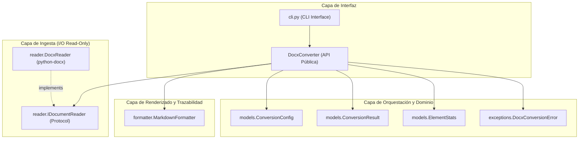

# PLAN DE DISEÑO TÉCNICO Y ARQUITECTURA (TDD) — CONVERTIDOR DOCX A MARKDOWN

- **Proyecto:** `docx_to_markdown`
- **Task ID:** `sprint_01_conversion`
- **Fase SDLC:** Fase B (Diseño Técnico y Arquitectura)
- **Agente:** `Architect_Agent`
- **Skills Activas:** `python_architect`, `document_conversion`
- **Especificación de Referencia:** `docx_to_markdown/specs/sprint_01_conversion/spec.md`
- **Estado:** APPROVED

---

## 1. RESUMEN ARQUITECTÓNICO Y PRINCIPIOS DE DISEÑO

El sistema `docx_to_markdown` implementa una arquitectura modular desacoplada en capas bajo principios SOLID y tipado estático estricto (PEP 484):



### Aplicación de Principios SOLID:
1. **Single Responsibility (SRP):**
   - `models.py`: Estructuras de datos inmutables y de telemetría.
   - `exceptions.py`: Jerarquía de errores del dominio.
   - `reader.py`: Apertura segura en solo lectura, validación ZIP/OOXML y extracción de elementos atómicos.
   - `formatter.py`: Transformación de elementos estructurados a sintaxis Markdown GFM.
   - `converter.py`: Orquestador del flujo y emisor del manifiesto de conversión.
   - `cli.py`: Interfaz de línea de comandos y parseo de argumentos.
2. **Open/Closed (OCP) & Liskov Substitution (LSP):**
   - La interfaz `IDocumentReader` permite intercambiar implementaciones de lectura (ej. mock en memoria, lector nativo XML) sin modificar el formateador ni el orquestador.
3. **Dependency Inversion (DIP):**
   - `DocxConverter` recibe `IDocumentReader` opcionalmente inyectado en su constructor.

---

## 2. ESQUEMAS DE DATOS Y CONTRATOS (PEP 484)

### 2.1 Modelos de Dominio (`docx_to_markdown/models.py`)

```python
from dataclasses import dataclass, field
from enum import Enum, auto
from pathlib import Path
from typing import Any, Dict, List, Optional, Tuple

class ElementType(Enum):
    """Tipos de elementos soportados en la extracción semántica."""
    HEADING = auto()
    PARAGRAPH = auto()
    LIST_ITEM = auto()
    TABLE = auto()
    IMAGE = auto()
    FOOTNOTE = auto()
    UNSUPPORTED = auto()

@dataclass(frozen=True)
class ConversionConfig:
    """Configuración de parámetros de conversión."""
    extract_images: bool = True
    assets_dir_name: str = "assets"
    table_cell_linebreak_replacement: str = "<br>"
    emit_manifest: bool = True
    ignore_empty_paragraphs: bool = True

@dataclass
class ElementStats:
    """Métricas cuantitativas de elementos parseados."""
    paragraphs: int = 0
    headings_by_level: Dict[int, int] = field(default_factory=dict)
    tables: int = 0
    table_cells: int = 0
    images: int = 0
    footnotes: int = 0

@dataclass
class ExtractedImage:
    """Imagen binaria extraída del paquete OOXML."""
    filename: str
    data: bytes
    rel_path: str
    sha256: str
    alt_text: str = ""

@dataclass
class DocumentElement:
    """Elemento atómico extraído del documento DOCX."""
    element_type: ElementType
    content: Any  # str para texto/encabezados, List[List[str]] para tablas, ExtractedImage para imágenes
    level: int = 0  # Nivel de encabezado (1-6) o indentación de lista (0+)
    metadata: Dict[str, Any] = field(default_factory=dict)

@dataclass
class ConversionResult:
    """Resultado del proceso de conversión y trazabilidad."""
    source_path: Path
    output_path: Path
    stats: ElementStats
    warnings: List[str]
    duration_ms: float
    success: bool
```

### 2.2 Jerarquía de Excepciones (`docx_to_markdown/exceptions.py`)

```python
class DocxConversionError(Exception):
    """Excepción base para fallos del convertidor."""

class DocumentNotFoundError(DocxConversionError, FileNotFoundError):
    """Lanzada cuando el archivo DOCX especificado no existe."""

class InvalidDocxError(DocxConversionError, ValueError):
    """Lanzada cuando el archivo no es un documento OOXML válido o está corrupto."""
```

---

## 3. FIRMAS DE MÉTODOS Y PROTOCOLOS

### 3.1 Protocolo del Lector (`reader.py`)

```python
from typing import List, Protocol
from pathlib import Path
from docx_to_markdown.models import DocumentElement

class IDocumentReader(Protocol):
    """Protocolo abstracto para lectores de documentos."""
    def read(self, file_path: Path) -> List[DocumentElement]:
        """Extrae la secuencia ordenada de elementos del documento."""
        ...
```

### 3.2 Clase Concreta `DocxReader` (`reader.py`)

```python
class DocxReader:
    """Lector OOXML implementado sobre python-docx y zipfile en modo de solo lectura."""
    def validate_file(self, file_path: Path) -> None:
        """Verifica la existencia y validez del archivo como contenedor OOXML."""
        ...

    def read(self, file_path: Path) -> List[DocumentElement]:
        """Abre el archivo en solo lectura y procesa párrafos, estilos, tablas e imágenes."""
        ...
```

### 3.3 Formateador Markdown (`formatter.py`)

```python
class MarkdownFormatter:
    """Generador de sintaxis Markdown GitHub Flavored (GFM)."""
    def __init__(self, config: ConversionConfig) -> None: ...

    def format_heading(self, text: str, level: int) -> str: ...
    def format_paragraph(self, text: str) -> str: ...
    def format_list_item(self, text: str, level: int, is_ordered: bool, index: int = 1) -> str: ...
    def format_table(self, rows: List[List[str]]) -> str: ...
    def format_image_link(self, rel_path: str, alt_text: str) -> str: ...
    def format_warning(self, message: str) -> str: ...
    def format_elements(self, elements: List[DocumentElement]) -> Tuple[str, List[str]]: ...
```

### 3.4 Orquestador `DocxConverter` (`converter.py`)

```python
class DocxConverter:
    """Orquestador principal del proceso de conversión."""
    def __init__(
        self,
        config: Optional[ConversionConfig] = None,
        reader: Optional[IDocumentReader] = None,
        formatter: Optional[MarkdownFormatter] = None
    ) -> None: ...

    def convert(self, input_path: Path | str, output_path: Path | str) -> ConversionResult:
        """Ejecuta la pipeline completa y emite el Markdown y manifiesto."""
        ...
```

---

## 4. ESTRATEGIA DE PRUEBAS Y UMBRALES DE QA

1. **Pylint Quality Gate:** Puntaje $\ge 7.0/10.0$ (Objetivo: $10.0/10.0$).
   - Todos los módulos con docstrings completos.
   - Longitud máxima de línea $\le 100$ caracteres.
   - Sin variables o imports no utilizados.
2. **Pytest Coverage Quality Gate:** Cobertura $\ge 80\%$.
   - Cobertura de casos nominales: títulos, párrafos con estilos inline, tablas con pipes y saltos de línea, imágenes incrustadas.
   - Cobertura de frontera y errores: archivo inexistente (`DocumentNotFoundError`), archivo corrupto/no-zip (`InvalidDocxError`), tablas vacías, caracteres Unicode complejos (ñ, tildes, emojis).
   - Uso de `tmp_path` de pytest para aislar escrituras sin efectos secundarios en el sistema de archivos.
